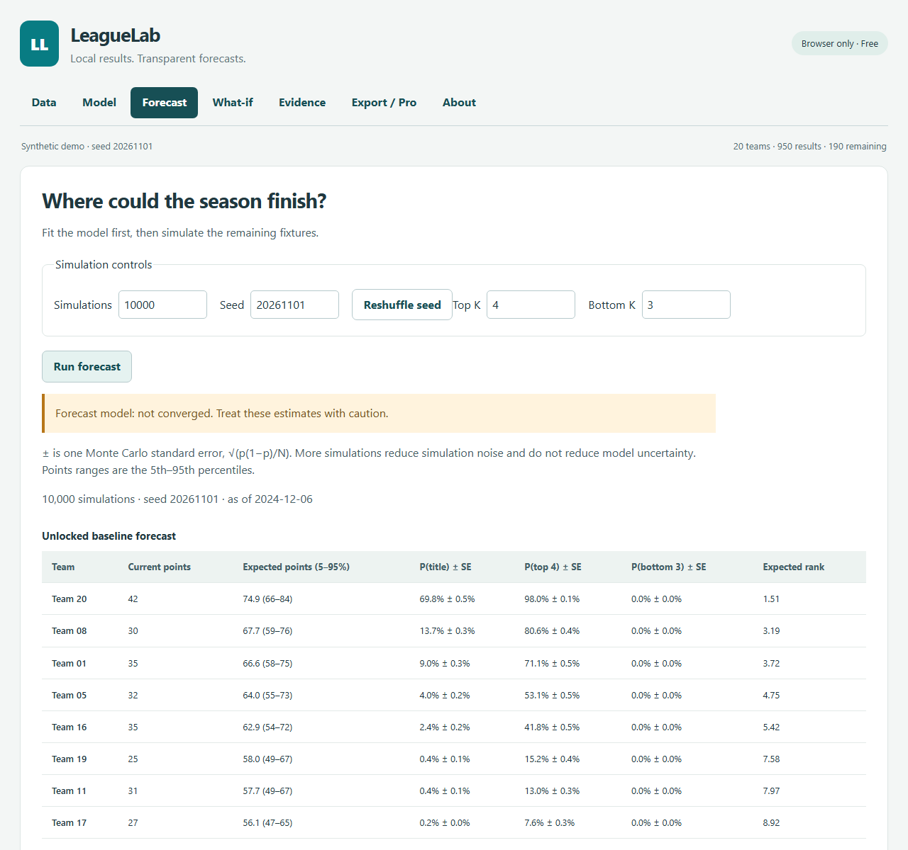

# LeagueLab

LeagueLab is a client-only football league forecasting app built with TypeScript, React and Vite. Import completed results and remaining fixtures, fit a time-decayed Dixon–Coles model, simulate the rest of a season, explore fixed-result scenarios, and inspect chronological evidence against a simple baseline. All calculations run locally; React and its DOM renderer are the only runtime packages. The default synthetic demo has 20 teams, 950 completed results and 190 remaining fixtures.



## Scope

<!-- scope-statement:start -->
LeagueLab supports one flat double round-robin league: every ordered home/away pair plays exactly once, with 3/1/0 points. It does not do betting, odds conversion or tips. It has no bookmaker integration or other gambling functionality. It does not support playoffs, groups, knockout rounds, split seasons or multiple leagues at once.
<!-- scope-statement:end -->

## Quick start and your CSVs

Use **Node.js 24** (also required for the TypeScript development-key script):

```sh
npm ci
npm run dev
```

Open the local URL printed by Vite. The synthetic demo is loaded initially; **Load demo league** resets it. Go to Model → Fit model, then Forecast → Run forecast. Evidence → Run backtest evaluates the history and then reports half-life sensitivity. Fit, gradient checks, simulation and evidence use Web Workers; running tasks can be cancelled. Seed, run count and position thresholds are editable. Changing inputs invalidates dependent results.

Download your own completed-results CSVs from [football-data.co.uk](https://www.football-data.co.uk/). No real-world data is bundled. Keep downloads under gitignored `data/local/`. Select all desired historical seasons together in the completed-results drop zone; a new selection replaces the loaded history. Importing the first file replaces the demo. Import a separate remaining-fixtures file for the current season. No uploads or application network requests occur. The placeholder Buy link opens an external page only when clicked.

Completed results:

```csv
Date,HomeTeam,AwayTeam,FTHG,FTAG
2026-01-01,A,B,2,1
```

Remaining fixtures (Date is optional):

```csv
HomeTeam,AwayTeam,Date
B,A,2026-01-08
```

Dates accept ISO `yyyy-mm-dd`, `dd/mm/yyyy` and `dd/mm/yy` (two-digit years mean 2000–2099). Team names are trimmed; quoted fields are supported. The importer whitelists Date, HomeTeam, AwayTeam, FTHG and FTAG, with optional Div and Time; other columns are ignored by construction. Goals must be nonnegative integers. Rejected rows show file and physical line numbers and require acknowledgment. Unknown teams, missing or duplicated ordered pairs, incorrect totals and invalid season boundaries independently block analysis. The current-season completed and remaining fixtures together must total N(N−1).

The suggested season start follows the last gap longer than 45 days. Override it in Data when necessary. Training uses all loaded history; standings use only results on or after that date.

## Method

For home h and away a:

```text
log λ = c + η + attack[h] − defense[a]
log μ = c + attack[a] − defense[h]
ρ = 0.2 × tanh(r)
P(x,y) = τ(x,y) × Pois(x; λ) × Pois(y; μ)
```

Attack and defense are centered. Higher defense means fewer conceded goals. The low-score corrections τ are `1−λμρ`, `1+λρ`, `1+μρ`, and `1−ρ` for 0–0, 0–1, 1–0 and 1–1 respectively; otherwise τ is one. Predictions truncate each score at 10 goals and renormalize. Invalid corrections fail explicitly: a bound on ρ alone cannot guarantee a valid PMF at arbitrary rates.

Training uses **date < cutoff**, weighted by `exp(−ln(2) × ageDays / 300)`. The objective is weighted mean negative log likelihood, omitting constant log-factorials, plus `0.01 × (sum(attack²) + sum(defense²))`. **Ridge regularization is a disclosed deviation from the original Dixon–Coles model**, stabilizing small samples. The fitted likelihood is untruncated; prediction uses the truncated PMF. Forecast settings can be edited, but evidence always uses frozen defaults in `src/config/defaults.ts`.

The hand-written optimizer uses analytic gradients, centered parameter projections, Armijo backtracking (1e-4, step shrink 0.5, growth 2), a 5,000-iteration maximum, gradient tolerance 1e-7, or five relative objective decreases below 1e-12. Relative decrease divides by max(1, absolute previous objective). The intercept starts at log weighted mean goals; other parameters start at zero. Objective convergence need not reach the gradient tolerance. Observed τ ≤ 1e-6 gives an infinite objective; empty, all-zero-goal and effectively zero-weight training samples fail explicitly. A 100-backtrack safety bound reports line-search failure honestly.

Forecasts use the day after the last completed result as cutoff. Seeded Mulberry32 samples precomputed joint CDFs, one uniform per unlocked fixture. Each simulation starts with actual standings and locked scores. Tie-breaks are points, goal difference, goals for, then a seeded random draw; **no head-to-head**. For a finished season, the seeded final tie draw stays fixed across runs so the result equals its completed table.

Outputs include the complete position matrix, title/top-K/bottom-K probabilities, expected rank and points with nearest-rank 5th–95th percentiles. Probability uncertainty shown as ± is one Monte Carlo standard error, `sqrt(p(1−p)/N)`. **10,000 simulations do not remove model uncertainty.** What-if results show changes against the unlocked forecast with matching simulation controls.

## Evidence and honesty

Evaluation begins only when at least 100 strictly earlier matches exist. Seven-day windows are anchored at the first eligible date; each block trains at its first observed date, strictly excluding that date and later dates. One warm-started fit predicts the entire block. The baseline uses weighted empirical home/draw/away frequencies from exactly the same training sample, with +1 smoothing. No evaluation results select hyperparameters. Half-lives 120, 300, 600 days and no decay are reported separately without picking a winner.

Metrics are ordered home/draw/away RPS (half the squared cumulative error over the first two classes), multiclass log loss (floor 1e-12) and unscaled multiclass Brier. Each paired baseline-minus-model loss gain has a seeded 2,000-resample percentile bootstrap 95% interval. These intervals are approximate because matches are not independent. The RPS verdict says “Model better than baseline” only when the lower endpoint exceeds zero, “Baseline better” only when the upper endpoint is below zero, otherwise “Inconclusive on this sample.” Fewer than 200 test matches triggers a warning.

Calibration pools three classes into ten equal-width bins, with counts, mean prediction, observed frequency and Wilson intervals. Bins below 20 observations are greyed and labeled “too few to read.” Calibration from small samples is descriptive evidence, not proof of accuracy. Every block exposes cutoff, training size, effective sample, iterations, objective, gradient norm and convergence reason; a free cutoff-audit CSV preserves these diagnostics.

### Acceptance gates

Fixed-seed synthetic checks, not real-league validation. Full null and signal backtests each evaluate **1,040 matches in 104 blocks** (three 20-team seasons, seed 20261101). Thresholds and defaults were fixed before evaluation.

| Gate | Result | Measured evidence |
|---|---|---|
| G1 | Pass | All 9 coordinates at 5 seeded points; maximum relative gradient error 7.39e-10 < 1e-5 |
| G2 | Pass | 220 training matches; 920 on/after-cutoff results randomized, 907 changed; 10 target predictions and 584 numeric bytes identical, maximum difference 0; complete pipeline equality across 13 sequential blocks |
| G3 | Pass | Null RPS model 0.235365527106 vs baseline 0.228853446792; gain −0.006512080314 ≤ +0.001; CI [−0.010753181068, −0.002409580644]; Baseline better |
| G4 | Pass | Signal RPS model 0.208139786342 vs baseline 0.233723360924; gain +0.025583574582; CI [+0.018186699243, +0.033385073209]; Model better than baseline; ECE 0.020489461851 < 0.05 |
| G5 | Pass | Attack correlation 0.9933, RMSE 0.0397; defense correlation 0.9717, RMSE 0.0679; required correlations > 0.9, RMSE < 0.12. ρ −0.10921 vs −0.10 (error 0.00921 < 0.05); η 0.19409 vs 0.20 (error 0.00591 < 0.08) |
| G6 | Pass | Largest exact-enumeration position error 0.001742 at 100,000 runs; every cell within 6 standard errors + 0.0001; row/column sums, sampled means, finished seasons, seeded reproducibility, locks and tie-break tests pass |
| G7 | Pass | Every fit carries actual convergence diagnostics; exhausted fits and rendered warnings tested. Recovery converges in 1,060 iterations; null 104/104 and signal 77/104 block fits converge |
| G8 | Pass | 11 importer tests, plus browser acknowledgment and format-blocking checks |
| G9 | Pass | Exact source/README copy-lint passes with only the scope block exempted |

G5 uses 2,280 matches over six seasons and explicitly **no decay** to retain its recovery sample; the default ridge remains unchanged. Its gradient norm is approximately 1.45e-5 at objective convergence. G7 means honest convergence reporting, **not universal numerical convergence**. The 27 unconverged signal blocks reach the unchanged iteration limit, with gradient norms approximately 6.50e-6–0.001384. Their predictions remain in the metrics and their warnings remain visible. No seeds, thresholds or defaults were adjusted to improve evaluation results.

The shorter UI demo evaluates 850 matches: rounded RPS gain 0.0237, interval [0.0147, 0.0319], ECE 0.0226, and 18 unconverged blocks. It differs from G4 because 190 current-season matches are reserved as remaining fixtures.

**No real-data backtest run was performed.** Synthetic evidence demonstrates implementation behavior, not predictive accuracy on a real league or commercial demand.

### Validation and timing

Final validation: **73/73 Vitest tests across 12 files, 3/3 Chromium tests, 76/76 total**. TypeScript and production build pass. These are distinct tests; the focused 31-test numerical rerun is a subset, not extra tests.

| Operation | Measured | Brief budget | Result |
|---|---|---|---|
| Fit, 20 teams / 760 matches | 100.83 ms | < 1,000 ms | Pass |
| Forecast, 20 teams / 190 fixtures / 10,000 runs | 117.94 ms | < 4,000 ms | Pass |
| Null backtest, 104 blocks / 1,040 test matches | 3.320 s | < 30 s | Pass |
| Signal backtest, 104 blocks / 1,040 test matches | 10.093 s | < 30 s | Pass |
| Six-season parameter-recovery fit | 291.77 ms | No separate budget | Converged |

Timing budgets concern individual core operations, not running the whole test suite or all four sensitivity runs. Local Windows / Node.js 24 measurements exclude browser startup and rendering; they are not hardware-independent guarantees.

## Free and Pro

| Feature | Free | Pro |
|---|---|---|
| Import, fit, forecast, Evidence and backtest | Included | Included |
| Simulation cap | 50,000 | 100,000 |
| Fixed-result locks | 1 | Unlimited |
| Forecast CSV | LeagueLab footer credit | No footer credit |
| Static HTML widget | — | Included |
| SVG and PNG title-probability charts | — | Included |
| Saved scenario snapshots and comparison | — | Up to 20 |

Export / Pro exports the most recent computed locked scenario when available, otherwise the unlocked forecast. The widget is a self-contained HTML snippet with inline CSS, a probability table, as-of date and uncertainty footer, and **no JavaScript**. Chart exports include accessible SVG text and a convergence warning when applicable; PNG is rasterized locally. Names are escaped in markup and formula-like CSV names are neutralized.

Saved snapshots persist inputs, fit, locks and results in localStorage. They are named, deletable and comparable (second minus first). Comparisons require identical datasets, fits, seeds, counts and thresholds; different locks are allowed. Snapshots are for comparison, not a full workspace restore. Clearing browser storage deletes keys and scenarios. Storage denial, corruption and quota failures are reported; clear saved scenarios to recover damaged storage. CSV uploads themselves are not persisted unless included in an explicitly saved snapshot.

**License stub: client-side only, trivially bypassable. It does not validate monetization. Real server-side validation is required before charging anyone.** No payment processing is implemented. The Buy button and price are placeholders configured in `src/config/pricing.ts`, not a pricing decision.

```sh
npm run make-key
```

Paste the generated development key in Export / Pro. Keys use `LL1-XXXXX-XXXXX-XXXXX-CCCC`, with CRC-16 over a body prefixed by a public source constant. This detects typos, not forgery. The normalized key persists in localStorage and is revalidated when entitlements are checked. All tier decisions use `can(feature)` and `limit(feature)` in `src/license/entitlements.ts`. The storage activation/deactivation shape follows the sibling Riderboard project.

## Known limits and scope decisions

- Point-estimate ratings only: the optional 30-resample rating-uncertainty bootstrap was cut as the brief's first-priority stretch cut. No claim of parameter uncertainty is made.
- One flat double round-robin league, fixed 3/1/0 points and no head-to-head tie-break. No injuries, lineups, player data, xG, accounts, backend or live fetching.
- No real-data evaluation; synthetic success does not establish real-world accuracy. Training teams must have appeared in completed data.
- Some backtest fits reach the iteration limit; all remain labeled. Sparse calibration and dependent-match bootstrap intervals require caution.
- Static exports do not update themselves. The chart export is the title-probability chart; the app also displays the position heatmap and calibration SVG with table alternatives.
- Saved snapshots are browser-local and limited by browser storage capacity; they cannot sync across devices. Large histories may exhaust quota before 20 snapshots.
- A finite 0–10 goal grid is renormalized. All-zero-goal training cannot use the prescribed initialization and is explicitly rejected.
- No requested phase-6 feature was cut. Half-life sensitivity, HTML widget and saved comparison shipped. Direct commits to main follow the user's instruction overriding the brief's branch convention.

## Development

```sh
npm test                         # All numerical gates, unit/integration and worker-backed UI tests
npm run test:watch
npx playwright install chromium  # Once per environment
npm run test:browser              # Real Chromium workflows and downloads
npm run build                    # TypeScript check and production bundle
npm run make-key                  # Development-only key
```

CI runs `npm ci`, `npm test` and `npm run build`; Chromium tests run locally. Core functions are pure and seeded. Browser tests exercise demo → fit → forecast → evidence, cancellation, imports, mobile overflow, license activation, multiple locks, saved comparisons and actual HTML/SVG/PNG downloads. No new runtime dependency was added for exports or licensing.

| Folder | Purpose |
|---|---|
| `src/core/` | Importer, Dixon–Coles PMF and fitter, gradient checker, tables, simulation, metrics, backtest, synthetic demo |
| `src/workers/` | Analysis and simulation worker entry points |
| `src/App.tsx`, `src/views.tsx`, `src/ExportPro.tsx` | Tabs, tables, accessible SVGs and export/license workflow |
| `src/license/` | Key format/checksum, storage and centralized entitlements |
| `src/export/` | Static markup, CSV/SVG/PNG export and saved snapshots |
| `src/config/` | Frozen model defaults and placeholder pricing |
| `scripts/` | Development-key generator |
| `tests/`, `tests/browser/` | Vitest and Chromium checks |
| `docs/` | Product screenshot |
| `data/local/` | Gitignored user-owned CSVs |

See [BUILD-BRIEF.md](BUILD-BRIEF.md) for the original specification.
